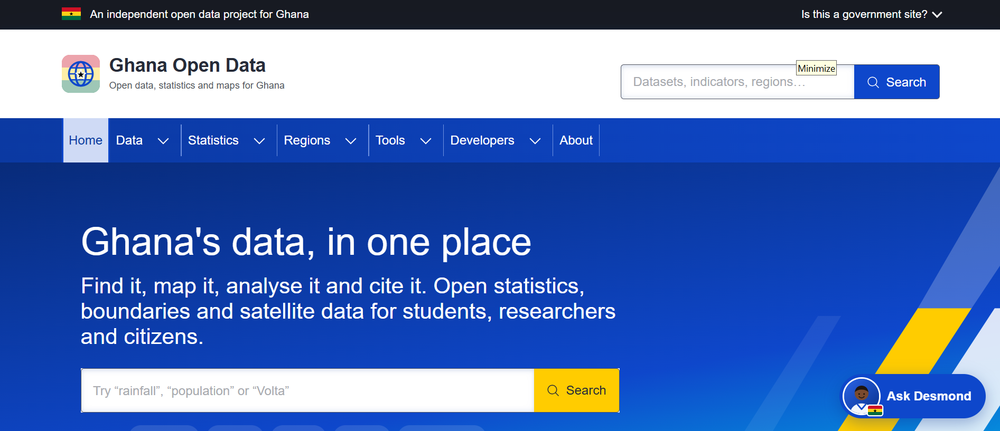
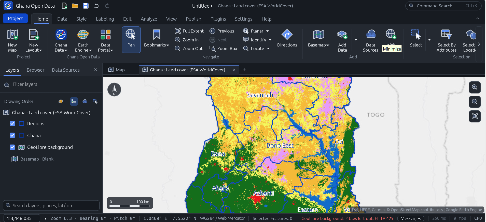

<h1 align="center">Ghana Open Data</h1>

<strong>Open data, statistics and maps for Ghana.</strong> 
Find it, map it, analyse it and cite it.

  <a href="https://ghana-open-data.vercel.app">Portal</a> ·
  <a href="https://desmond-lartey.github.io/ghana-open-data-plugin/">Documentation</a> ·
  <a href="https://ghana-open-data.vercel.app/contribute">Share data</a> ·
  <a href="https://github.com/desmond-lartey/ghana-open-data-plugin/issues/new/choose">Feedback</a>

This is the public home of **Ghana Open Data**: its documentation, its community catalogue of shared datasets, and the place to give feedback. The portal and its GIS workspace are developed in a separate repository; this one is updated from it automatically.

## What is Ghana Open Data?

| | |
|---|---|
| **Data browser** | Boundaries, national statistics, satellite layers, community datasets and Ghana's datasets on HDX, each with its licence and source |
| **Statistics** | Ghana's indicators over time against its neighbours, freshest figures first (World Bank, IMF) |
| **Regions** | Profiles of the 16 regions and all 260 districts |
| **GIS workspace** | A full desktop-style GIS in the browser, with Ghana's layers one click away |
| **Earth Engine** | Land cover, elevation, rainfall, population and more over Ghana, with your own account |
| **Data Lab** | SQL in the browser on regions, districts and indicators |
| **Share data** | A Zotero-style form to share data from articles, surveys and reports, reviewed by the team |

## Get involved

- **Share a dataset**: use [Share data](https://ghana-open-data.vercel.app/contribute) on the portal. Approved datasets appear in [`community/datasets/`](community/datasets/) and in the [community catalogue](https://desmond-lartey.github.io/ghana-open-data-plugin/share/catalogue/).
- **Report a problem or suggest an idea**: [open an issue](https://github.com/desmond-lartey/ghana-open-data-plugin/issues/new/choose).
- **Improve the documentation**: see [CONTRIBUTING.md](CONTRIBUTING.md).

## Licences

The documentation is © Ghana Open Data contributors, [CC BY 4.0](https://creativecommons.org/licenses/by/4.0/). The descriptions in `community/` are [CC0](https://creativecommons.org/publicdomain/zero/1.0/). Each dataset keeps its own licence, shown with it.

Ghana Open Data is an independent project. It is not run by the Government of Ghana or the Ghana Statistical Service.
