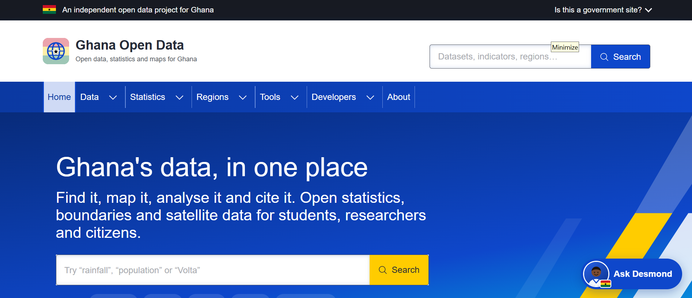

# Getting started

This page takes about five minutes and walks through the portal's main paths.

## 1. Open the portal

Go to **[ghana-open-data.vercel.app](https://ghana-open-data.vercel.app)**. The home page shows Ghana's key indicators, a map of the regions and the ways in: data, statistics, regions and tools.

{ .gh-shot }

## 2. Find a dataset

Use the search box at the top of any page, or open **Data** in the menu. Filter by theme (population, economy, environment…) or by type (statistics, boundaries, satellite, community). Every dataset has a page with a preview, its licence, its source and ways to use it.

## 3. Create a free account

Click **Sign in** in the header, then **Register**. You need an account to download files, run SQL in the Data Lab, open the GIS workspace and use Earth Engine. Browsing stays open to everyone. See [Your account](using/account.md).

## 4. Put something on a map

On any boundary or satellite dataset, press **Open in GIS workspace**. The workspace opens in a new tab with the data styled and labelled. See [GIS workspace](gis/index.md).

## 5. Ask Desmond

Not sure where something is? Click **Ask Desmond** in the corner of any page and ask in plain words, for example *"where are the district boundaries?"* See [Desmond](using/desmond.md).
