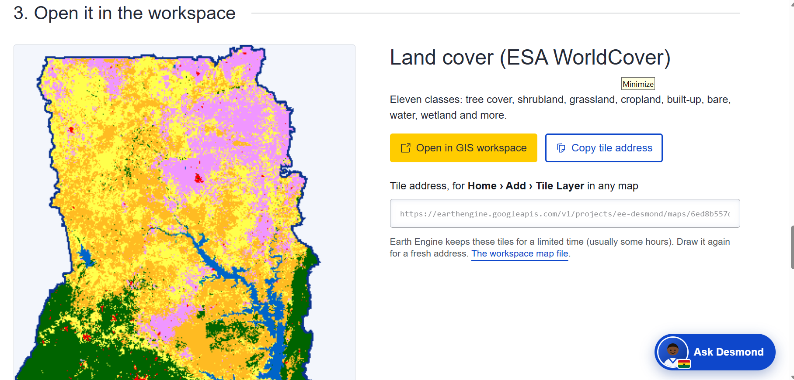
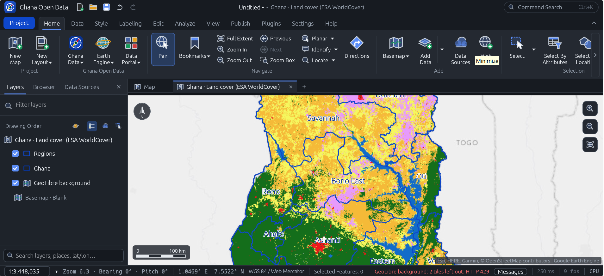

# Earth Engine

The Earth Engine connector draws Google Earth Engine datasets over Ghana with **your own** Earth Engine account, and opens them in the GIS workspace under Ghana's boundaries.

## What you need

- A free Ghana Open Data account.
- A Google account registered for Earth Engine, and a Cloud project (for example `ee-yourname`). Registration is free for non-commercial and research use at [code.earthengine.google.com/register](https://code.earthengine.google.com/register).

## Step by step

1. Open **Tools › Earth Engine** (or **Earth Engine** in the workspace's Ghana Open Data group).
2. Type your Cloud project and press **Sign in with Google**. Approve read-only access to Earth Engine. A warning that Google hasn't verified the app may appear while the site is being verified: choose **Continue**.
3. Choose a dataset and press **Draw**. Dates and the clip to Ghana's border apply to all of them.
4. Look at the preview, then press **Open in GIS workspace**.

{ .gh-shot }

{ .gh-shot }

## Datasets ready to draw

Cloud-free Sentinel-2, ESA WorldCover land cover, Dynamic World land use, Copernicus elevation, CHIRPS rainfall, Hansen forest loss, JRC surface water, WorldPop population, GHSL built-up surface, VIIRS night lights, MODIS burned area, Landsat surface temperature, HydroSHEDS river basins and urban boundaries. Any other Earth Engine asset can be drawn by its id.

## Pictures and values

The map layer is a picture, made for looking. To analyse the numbers behind it (elevation in metres, people per cell, rainfall in millimetres), use **Open values in GIS workspace** or **Download GeoTIFF** under the preview: they give the real values, clipped to Ghana, which the workspace's raster tools (zonal statistics, reclassify, raster calculator) work on, as do QGIS, R and Python. See [Analysis-ready data](analysis-ready.md).

!!! warning "Tiles expire"
    Earth Engine keeps a drawn layer's tiles for a limited time, usually some hours. Draw it again for a fresh layer, or download the values to keep them.
