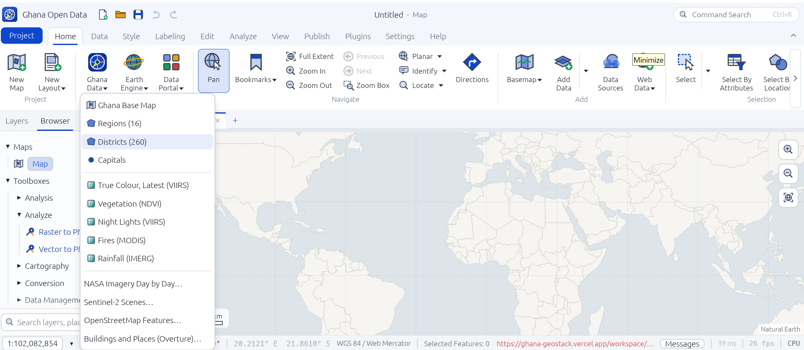

# Ghana's data in the workspace

The **Home** tab starts with a **Ghana Open Data** group, so you never have to go back to the portal to fetch a layer.

{ .gh-shot }

## Ghana Data

- **Ghana Base Map**: the border, regions, districts and capitals, styled and labelled.
- **Regions**, **Districts**, **Capitals**: each on its own.
- **Satellite maps**: true colour (VIIRS), vegetation (NDVI), night lights, fires and rainfall, under the regions.
- **NASA Imagery Day by Day**, **Sentinel-2 Scenes**, **OpenStreetMap Features** and **Buildings and Places (Overture)**: the workspace's own global services, which cover Ghana.

Each opens as a new map in your project, so what you have already done stays in its own map.

## Earth Engine and Data Portal

**Earth Engine** opens the [Earth Engine connector](earth-engine.md). **Data Portal** links back to the catalogue, statistics, region profiles and the Data Lab.

## Good to know

- Satellite imagery is published only to a certain zoom (for example about 300 m per pixel for VIIRS true colour). The workspace knows each layer's limit and enlarges the last level when you zoom in further.
- NASA publishes daily imagery with a delay of a day or two, and cloud cover is real. The workspace uses the newest day NASA has published.
- If a few tiles are left out with an "HTTP 429" message, the image service is asking for a short pause because of many requests at once. Pan or zoom a little and they load.
