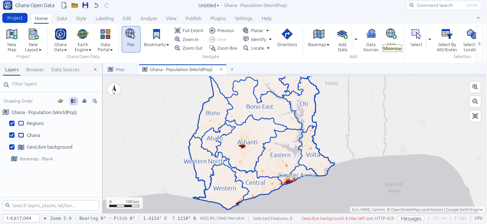

# GIS workspace

The GIS workspace is a complete desktop-style GIS that runs in your browser: layers, symbology, labels, geoprocessing tools, editing and print layouts, laid out like QGIS and ArcGIS Pro. It opens in its own tab and needs a free account.

{ .gh-shot }

## Opening it

- From a dataset page: **Open in GIS workspace** opens that layer, styled and labelled.
- From a region profile: the workspace opens on that region.
- From **Tools › GIS workspace**: the Ghana base map with the border, regions, districts and capitals.

## If you know QGIS or ArcGIS

| In the workspace | In QGIS | In ArcGIS Pro |
|---|---|---|
| Layers pane | Layers panel | Contents pane |
| Ribbon: Home, Data, Style, Edit, Analyze, View, Publish | Menus and toolbars | Ribbon |
| Analyze › Tools | Processing Toolbox | Geoprocessing pane |
| Model Builder | Graphical Modeler | ModelBuilder |
| Style tab | Layer Styling panel | Symbology pane |
| Layouts | Print Layout | Layout view |
| Command Search (Ctrl+K) | Locator bar | Command Search |

## Your own data

Drop a file on the map, or use **Add Data**: GeoJSON, CSV, Shapefile (zipped), GeoPackage, GeoParquet, FlatGeobuf, KML, GPX and GeoTIFF open in the browser. Files are read on your computer and are not uploaded. **Save** downloads a project file you can open again later.

The workspace is built on RustGIS, a free and open-source GIS (Apache 2.0), in an edition maintained by Ghana Open Data.
