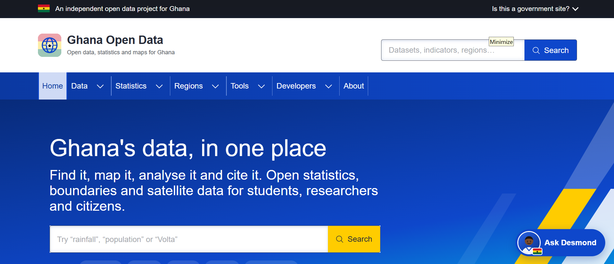

# Ghana Open Data

**Open statistics, boundaries, satellite data and community datasets for Ghana, to find, map, analyse and cite.**

Ghana Open Data is a free portal for students, researchers, journalists, public servants and citizens. Browse national and regional statistics, map Ghana's regions and districts in a GIS workspace that runs in your browser, draw satellite layers with Earth Engine, query data with SQL, and share datasets of your own with the community.

[Open the portal](https://ghana-open-data.vercel.app){ .md-button .md-button--primary }
[Get started](getting-started.md){ .md-button }
[GIS workspace](gis/index.md){ .md-button }
[Share your data](share/index.md){ .md-button }

{ .gh-shot }

## What you can do

-   :material-database-search:{ .lg .middle } **Find data**

    ---

    Browse boundaries, national statistics, satellite layers, community datasets and Ghana's datasets from UN agencies and NGOs, each with its licence and source.

    [:octicons-arrow-right-24: Finding data](using/finding-data.md)

-   :material-chart-line:{ .lg .middle } **Follow the numbers**

    ---

    Chart Ghana's indicators over time against its neighbours, with the freshest figures from the World Bank and the IMF.

    [:octicons-arrow-right-24: Statistics](using/statistics.md)

-   :material-map:{ .lg .middle } **Map and analyse**

    ---

    A full GIS in your browser, laid out like QGIS and ArcGIS Pro, with Ghana's layers one click away.

    [:octicons-arrow-right-24: GIS workspace](gis/index.md)

-   :material-earth:{ .lg .middle } **Earth Engine**

    ---

    Draw land cover, elevation, rainfall, forest loss or population over Ghana with your own Google Earth Engine account.

    [:octicons-arrow-right-24: Earth Engine](gis/earth-engine.md)

-   :material-database-arrow-right:{ .lg .middle } **Query with SQL**

    ---

    Run SQL on regions, districts and indicators in your browser, then chart or download the result.

    [:octicons-arrow-right-24: Data Lab](using/data-lab.md)

-   :material-share-variant:{ .lg .middle } **Share your data**

    ---

    Published an article with data about Ghana? Describe it like a reference, attach the files, and our team reviews it.

    [:octicons-arrow-right-24: Share data](share/index.md)

## Open by default

Browsing the portal never needs an account. Downloads and the analysis tools need a free account, as on Copernicus or NASA Earthdata: it takes a minute, and it tells us who uses Ghana's data. Every dataset keeps its original licence and credit line.

!!! note "An independent project"
    Ghana Open Data is an independent open data project. It is not run by the Government of Ghana or the Ghana Statistical Service, which is the authority for official statistics.
