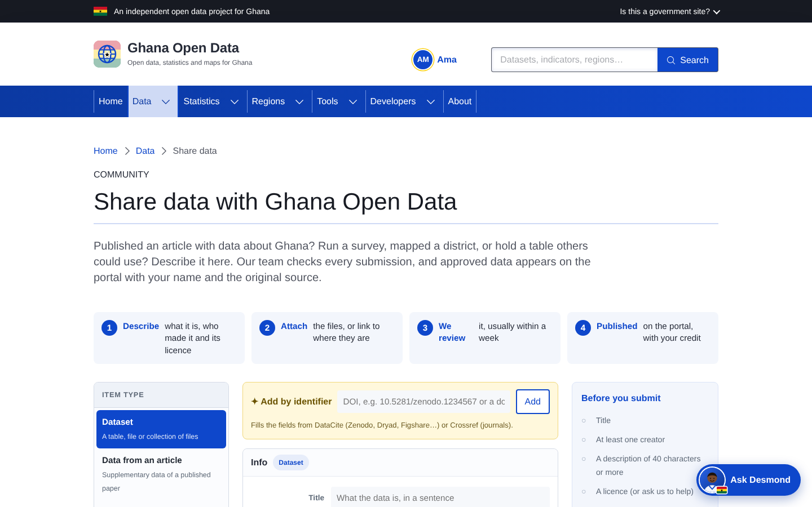

# Share data

Published an article with data about Ghana? Run a survey, mapped a district, or hold a table others could use? Share it on the portal. Our team checks every submission, and approved data appears on the portal and in the [community catalogue](catalogue.md) with your name and the original source.

{ .gh-shot }

-   **1. Describe**

    ---

    What it is, who made it and its licence. Add by DOI to fill the fields automatically.

-   **2. Attach**

    ---

    Files of any format (up to 10, 50 MB each), or links to where the data is.

-   **3. We review**

    ---

    The team checks the licence, the source and the files, usually within a week.

-   **4. Published**

    ---

    On the portal and in the community catalogue, credited to you and the original authors.

[Share data on the portal](https://ghana-open-data.vercel.app/contribute){ .md-button .md-button--primary }
[How to submit](how-to-submit.md){ .md-button }
