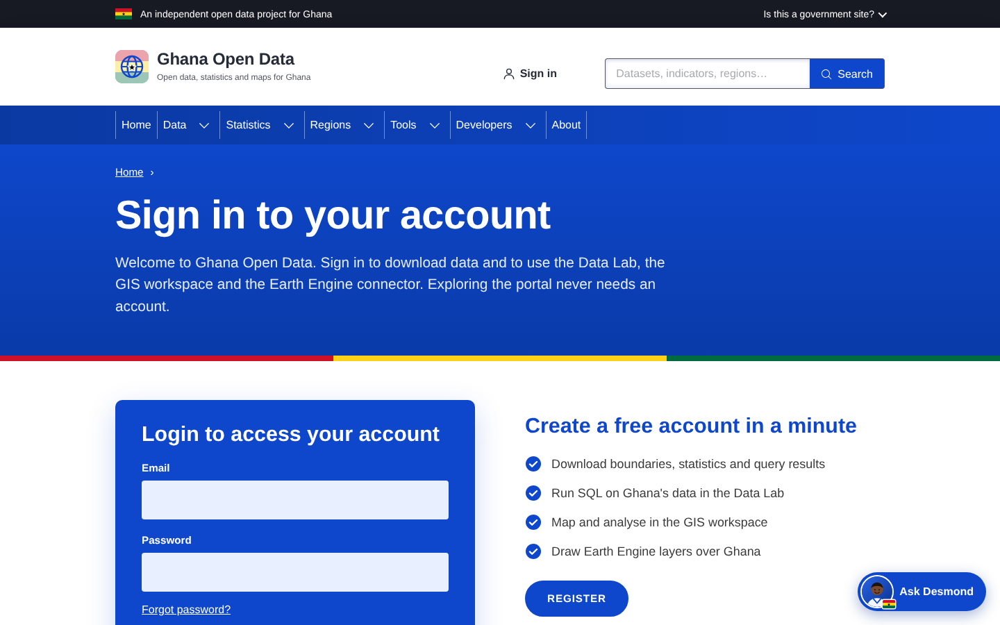

# Your account

Browsing the portal is open to everyone. A free account is needed to:

- download files, tables and query results;
- run SQL in the Data Lab;
- open the GIS workspace;
- use the Earth Engine connector.

{ .gh-shot }

## Creating an account

1. Click **Sign in** in the header, then **Register**.
2. Give your name, email and a password of at least 8 characters, and tell us what best describes you (student, researcher, journalist, public servant…). An organisation is optional.
3. Open the confirmation link we email you. You are then signed in and taken back to where you were.

## Forgotten password

On the sign-in page, choose **Forgot password?**, enter your email, and follow the link we send you.

## Your details

Click your initials in the header and choose **Your account** to change your name, role, organisation or email preferences, or to sign out. See [Privacy](../about/privacy.md) for what we keep.
