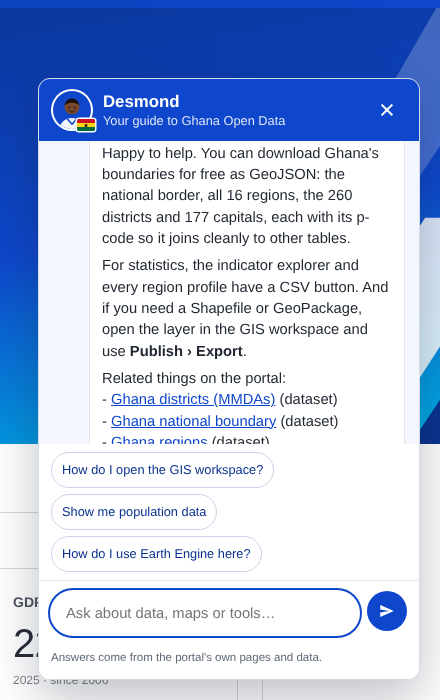

# Desmond, the guide

Every page has an **Ask Desmond** button in the corner. Desmond answers questions about the portal in plain words: where a dataset is, how a tool works, how to cite something.

{ .gh-shot width="380" }

Desmond answers from the portal itself: its pages, its catalogue, the regions, districts and their capitals, and the indicators. So every answer links to a real page or file. Try:

- *Where can I download district boundaries?*
- *Tell me about Tamale*
- *How do I use Earth Engine here?*
- *What can I do in the Data Lab?*

The conversation is kept only in your browser tab.
