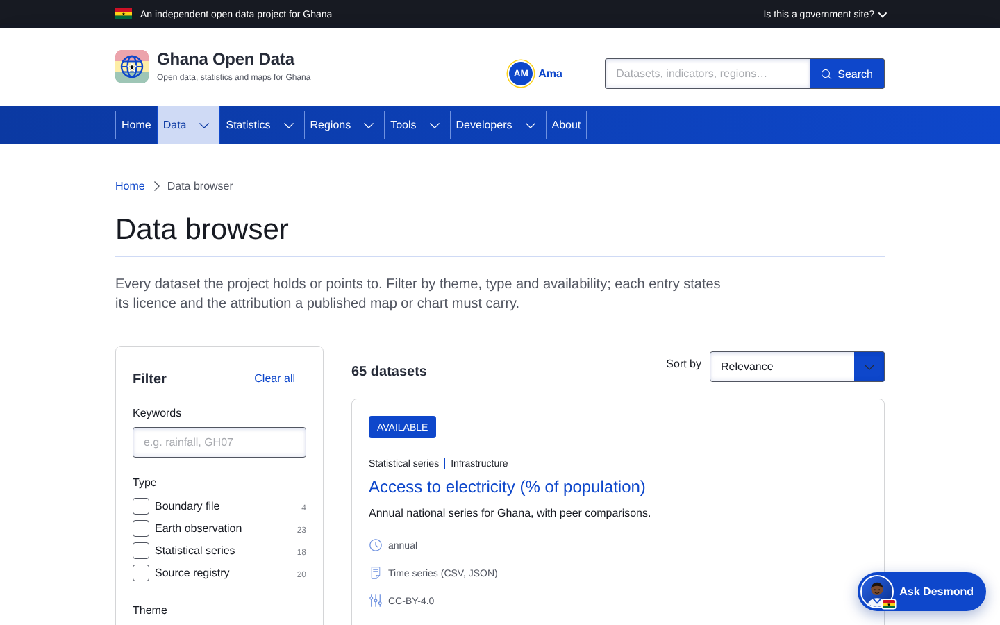
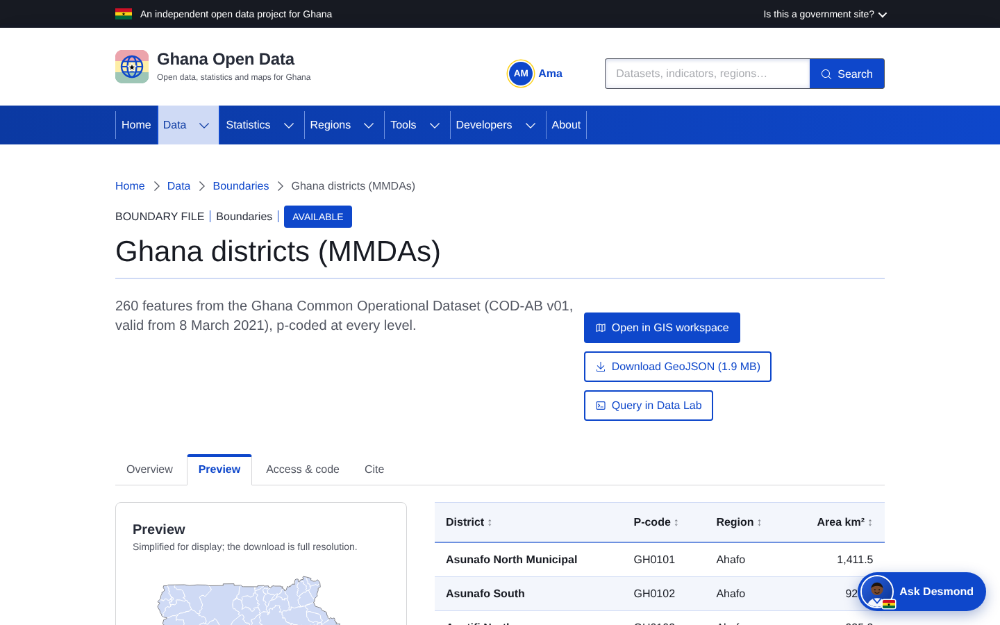

# Finding data

Open **Data** in the menu, or search from the box at the top of any page.

{ .gh-shot }

## What is in the catalogue

- **Boundaries**: the national border, 16 regions, 260 districts and 177 capitals, with official p-codes (OCHA Common Operational Dataset).
- **Statistics**: national indicators such as population, GDP growth, inflation, school enrolment and access to electricity.
- **Satellite layers**: true colour, vegetation, night lights, fires, rainfall and land surface temperature from NASA, plus datasets you can draw with Earth Engine.
- **Community datasets**: data shared by researchers, organisations and citizens and checked by the review team.
- **From HDX**: Ghana's datasets on the Humanitarian Data Exchange, run by UN OCHA, listed live: health facilities, population, conflict events, food prices, flooding and more.

## A dataset's page

Each dataset has a page with an overview, a preview (a table, a chart or a map), the ways to use it, and how to cite it.

{ .gh-shot }

!!! tip "Join on p-codes"
    Region and district names are spelled in different ways in different sources. Every boundary carries a p-code (for example `GH0701`); join tables on it, never on names.
