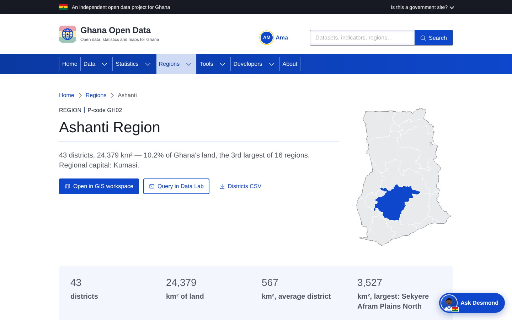

# Regions and districts

**Regions** lists Ghana's 16 regions on a map and in a table, with a finder for all 260 districts (MMDAs).

Each region has a profile with its districts on a map, their areas and capitals, rankings, and buttons to open the region in the GIS workspace or query its districts in the Data Lab.

{ .gh-shot }

!!! info "Areas"
    Areas are computed from the boundary polygons and will differ slightly from published figures.

Ghana has had 16 regions since 2019, when six new regions were created: Brong Ahafo became Bono, Bono East and Ahafo; Northern was divided into Northern, Savannah and North East; Volta into Volta and Oti; and Western into Western and Western North.
