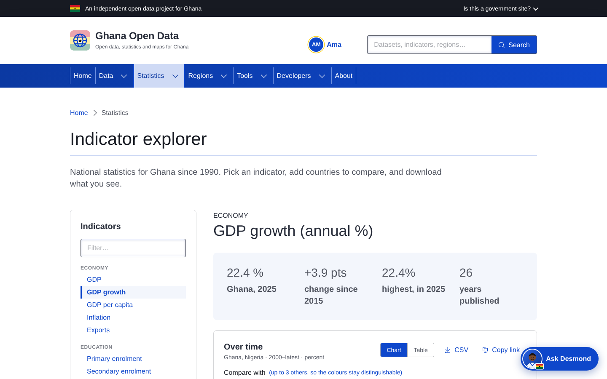

# Statistics

**Statistics** charts Ghana's national indicators over time. Pick an indicator on the left, and add comparison countries (Côte d'Ivoire, Nigeria, Togo and others) to see Ghana in context.

{ .gh-shot }

- Every chart has a **table** view and a **CSV** download.
- Under each chart, the source line says where every figure came from.
- A ranking shows where Ghana stands among the comparison countries for the latest year.

## How fresh are the numbers?

The World Bank's World Development Indicators are the backbone, but they can lag a year or more. For the economy, the IMF's World Economic Outlook fills the years the World Bank has not published yet, including the current-year estimate; those points are marked as coming from the IMF. Forecasts are never shown as the latest value.

Some indicators (literacy, poverty, school attendance) come from national surveys and censuses that run every few years, so the newest international figure can be several years old. When that happens, the page says so and points to the Ghana Statistical Service's StatsBank, where newer national figures may be. See [Keeping data fresh](../data/freshness.md).
